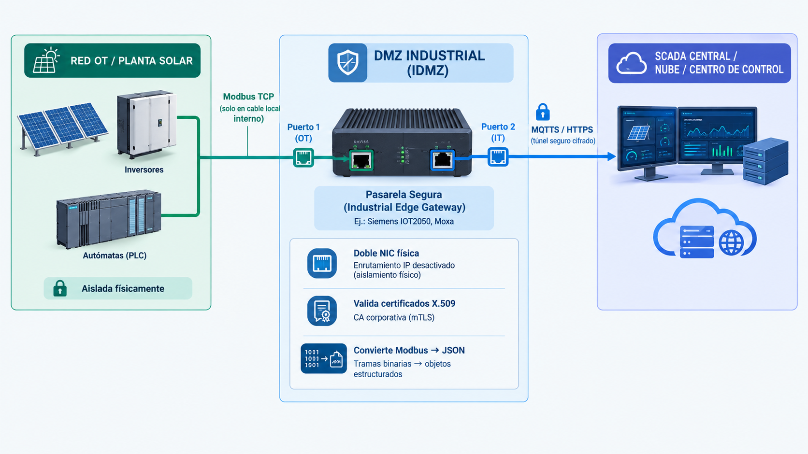
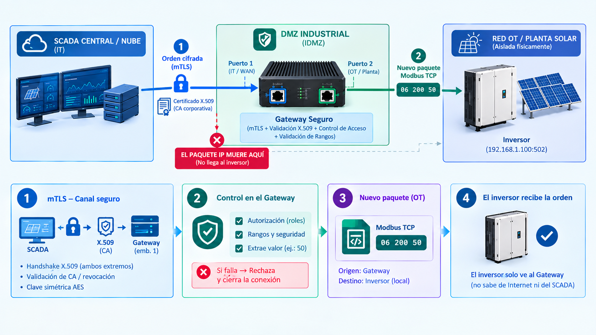
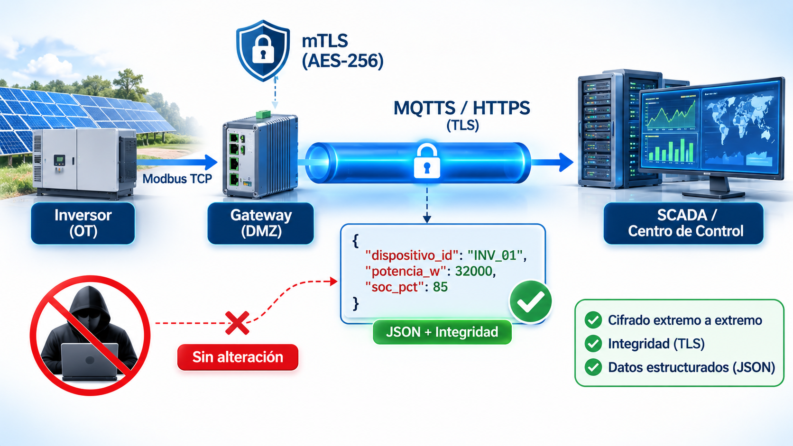
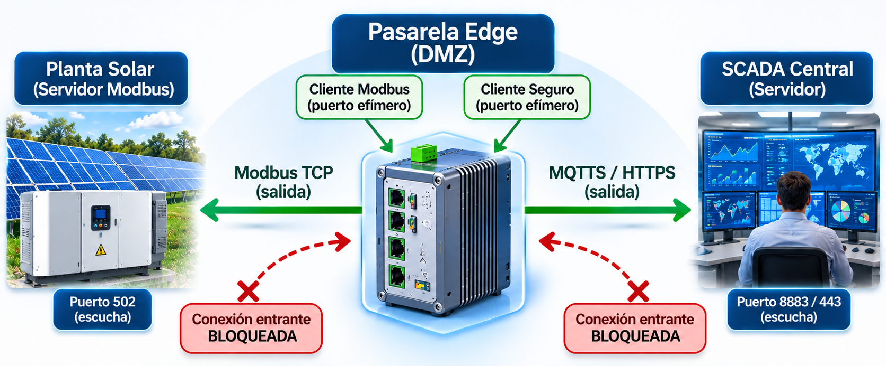

# Práctica: Supervisión y Control de un Inversor Fotovoltaico con Modbus TCP
**Asignatura:** Informática Industrial Aplicada  
**Titulación:** Grado en Ingeniería Eléctrica — Universidad de Valladolid (UVa)

---

## 1. Objetivos de la Práctica

El propósito de esta práctica es aplicar los conceptos de comunicaciones industriales y la arquitectura **Cliente-Servidor** mediante el protocolo estándar de facto en el sector eléctrico: **Modbus TCP**.

Al finalizar la práctica, el alumno será capaz de:
1. Comprender la separación física y conceptual entre un **equipo de campo (Servidor Modbus / PLC / Inversor)** y una **estación de supervisión (Cliente Modbus / SCADA / HMI)**.
2. Identificar y utilizar adecuadamente los tipos fundamentales de registros Modbus (**Coils**, **Input Registers** y **Holding Registers**) para transportar mandos, medidas y consignas.
3. Entender por qué un sistema distribuido real utiliza **archivos de configuración independientes** (formato **JSON**) en lugar de compartir ficheros o tener constantes escritas directamente en el código (*hardcodeadas*).
4. Ampliar un sistema industrial existente integrando una nueva funcionalidad (monitorización y control de una batería de almacenamiento de energía) sin romper la arquitectura previa.

---

## 2. El Problema Ingenieril

### Contexto Eléctrico: Autoconsumo Industrial con Inversor Fotovoltaico
En una instalación solar fotovoltaica conectada a red (como el tejado de una nave industrial o un parque de generación), los módulos solares producen electricidad en **Corriente Continua (DC)**. El elemento central de la instalación es el **Inversor Solar**, un convertidor estático de potencia encargado de:
* Realizar el seguimiento del punto de máxima potencia (**MPPT**) del campo solar (~680 V DC).
* Convertir la corriente continua en **Corriente Alterna (AC)** trifásica a 400 V / 50 Hz.
* Sincronizarse con la red eléctrica de distribución e inyectar energía cumpliendo estrictamente los códigos de red (control de frecuencia, tensión y protecciones).

> [!NOTE]
> ### 💡 ¿Qué es el MPPT y por qué ~680 V DC?
> 
> * **¿Qué es el MPPT (*Maximum Power Point Tracking*)?**  
>   La potencia eléctrica es el producto de la tensión por la corriente ($P = V \times I$). Un panel solar se comporta de una forma muy peculiar:
>   * Si dejas sus cables desconectados (circuito abierto), la tensión es máxima, pero la corriente es cero $\to$ **Potencia = 0 W**.
>   * Si juntas sus cables (cortocircuito), la corriente es máxima, pero la tensión cae a cero $\to$ **Potencia = 0 W**.
>   * Entre ambos extremos existe un **punto óptimo ("el punto dulce")** donde la combinación de tensión y corriente extrae los máximos vatios posibles.  
>   
>   El problema es que este punto óptimo **no es fijo**: varía segundo a segundo si pasa una nube, si cambia la inclinación del sol o si los paneles se calientan. El **MPPT** es un algoritmo de control dentro del inversor que "rastrea" y ajusta continuamente la carga eléctrica para exprimir hasta el último vatio disponible en cada instante.  
>   *Analogía:* Funciona como el cambio automático de una bicicleta: adapta continuamente el desarrollo para que las piernas del ciclista entreguen siempre la máxima fuerza independientemente de las pendientes o del viento.
>
> * **¿Por qué la tensión es de aproximadamente ~680 V DC?**
>   1. **Paneles en serie (*Strings*):** Un único panel solar comercial genera entre 35 y 45 V DC. En tejados industriales se conectan entre 15 y 20 paneles en serie formando cadenas o *strings*. Como las tensiones en serie se suman: $17 \text{ paneles} \times 40\text{ V} \approx \mathbf{680\text{ V DC}}$.
>   2. **Requisito físico para inyectar a 400 V AC:** Para que un convertidor electrónico pueda inyectar energía en una red trifásica de 400 V (valor eficaz), la tensión del lado de continua debe ser obligatoriamente superior al **valor de pico** de la onda senoidal entre fases ($\sqrt{2} \times 400\text{ V} \approx 565\text{ V}$). Un valor de ~680 V DC proporciona el margen físico necesario para sintetizar la onda de alterna sin recortarla.
>   3. **Eficiencia y grosor de cables:** Al elevar la tensión a 680 V, la corriente ($I = P / V$) para transportar 30 kW es mucho menor, lo que permite usar cables de cobre más finos y reduce drásticamente las pérdidas por calor ($I^2 \cdot R$).
>   *(Nota comparativa con autoconsumo residencial: en una vivienda con red monofásica a 230 V, el pico de la onda es de ~325 V, por lo que los inversores domésticos trabajan a tensiones de continua más bajas, típicamente ~350 V DC con 7-10 paneles en serie).*
>
> * **¿Qué ocurre al atardecer o cuando oscurece? ¿Por qué la potencia pasa a ser 0 W?**
>   Aunque todavía haya algo de luz visible en el cielo:
>   * **Autoconsumo del equipo:** Los procesadores, ventiladores y circuitos del inversor consumen entre 30 W y 80 W solo por estar activos. Si los paneles generan menos de esa cantidad, operarlo costaría dinero.
>   * **Tensión en vacío:** Al anochecer, un voltímetro puede seguir midiendo 400 V en los paneles, pero es "voltaje sin intensidad" (casi cero amperios). En cuanto se conecta una carga, la tensión colapsa.
>   * **Desconexión por umbral (*Cut-off*):** Cuando la radiación no es suficiente para superar las pérdidas y generar 400 V AC estables, el inversor abre sus contactores internos y pasa al estado **EN ESPERA (STANDBY)** o **PARADO**, marcando **0 W de potencia activa inyectada**.

```
  [ Campo de Paneles Solares DC ]
                 |
                 v
       [ INVERSOR SOLAR ] <======== Red Ethernet Industrial ========> [ SCADA CONTROL ]
        (Servidor Modbus)                  (Modbus TCP / IP)            (Cliente Modbus)
       Ubicado en el cuadro                                            Ubicado en sala
         eléctrico de campo                                              de operaciones
                 |
                 v
   [ Red Eléctrica AC 400V / 50Hz ]
```

Para operar la planta sin necesidad de desplazarse físicamente a cada cuadro, los inversores incorporan **interfaces de red industrial normalizadas**. Esto abarca dos niveles:
* **Nivel Físico (Hardware):** Puertos Ethernet (RJ45 apantallado o M12) o buses serie (RS-485) con **aislamiento galvánico**, protegiendo la red de comunicaciones frente a ruidos electromagnéticos y sobretensiones de los paneles.
* **Nivel Lógico (Protocolo y Datos):** Pila **TCP/IP** estándar en el **puerto 502** y el protocolo **Modbus TCP**. Como vimos en la _teoría_, Modbus proporciona **interoperabilidad** (todos los equipos hablan el mismo protocolo), pero por defecto carece de **intercambiabilidad** (cada fabricante asigna las direcciones de memoria que quiere). Para resolverlo en el sector solar, la industria creó **SunSpec Alliance**: un perfil de dispositivo normalizado que fija un _diccionario_ de registros común para que cualquier SCADA pueda sustituir un inversor por otro de distinta marca (*Plug & Play*) sin tener que reprogramar las direcciones.

> [!NOTE]
> ### 🔍 La "contradicción" entre la teoría y la práctica: ¿Por qué SunSpec mete todo en Holding Registers?
> 
> En la **teoría de la asignatura** explicamos que Modbus divide su memoria en cuatro tablas independientes por una razón de **seguridad funcional elemental**:
> * **Discrete Inputs** (lectura con Código de Función `02`): Entradas binarias de 1 bit, **solo lectura**. Reflejan estados físicos de campo que el software no puede forzar (presencia de tensión en la red, disparo de un relé térmico o interruptores seccionadores).
> * **Coils** (lectura con Función `01`, escritura con `05`): Salidas binarias de 1 bit, **lectura y escritura**. Son mandos digitales para actuar sobre el proceso (marcha/paro de relés o contactores).
> * **Input Registers** (lectura con Código de Función `04`): Registros de 16 bits, **solo lectura**. Mapeados a conversores A/D de medidas analógicas físicas (tensión, potencia, temperatura). Por diseño del protocolo, carecen de función de escritura para proteger los sensores.
> * **Holding Registers** (lectura con Función `03`, escritura con `06` y `16`): Registros de 16 bits, **lectura y escritura**. Reservados para consignas y parámetros de configuración que el operador sí debe poder modificar.
> 
> **¿Por qué entonces SunSpec y muchos fabricantes rompen esta regla y lo meten TODO en Holding Registers?**  
> Por puro pragmatismo y rendimiento de red:
> 1. **Optimización del sondeo (*polling*) en un solo paquete:** En Modbus es imposible pedir datos de tablas distintas en la misma trama. Si la potencia estuviera en Input Registers y el límite en Holding Registers, el SCADA tendría que enviar dos peticiones por separado. En una planta con decenas de inversores (especialmente en buses serie RS-485 lentos a 9600 o 19200 bps), duplicar el número de transacciones duplicaría también el tiempo de refresco de la planta, aumentando la latencia de supervisión. Agrupando todo contiguo en Holding Registers, el SCADA pide 60 datos seguidos de un solo golpe mediante una única Función `03`.
> 2. **Simplicidad de firmware:** Para el fabricante es más barato programar un único array de memoria en C (`uint16_t`) y responder siempre a la Función `03`. La seguridad la _parchean_ por software: si intentas escribir en el registro de la potencia, el microcontrolador devuelve un error (`Illegal Data Address`).
> 
> **¿Por qué en esta práctica mantenemos la pureza didáctica?**  
> Porque nuestro objetivo es formativo. Si utilizáramos la norma SunSpec estricta, solo se usarían Holding Registers y jamás se ejercitarían los mandos binarios (**Coils**) ni las medidas protegidas (**Input Registers**). Por ello, en esta práctica adoptamos las **mismas magnitudes y variables de la industria solar**, pero aplicadas sobre un **mapa de memoria bien diseñado**:
> * **Coils (`0`, `1`):** Mandos digitales de marcha/paro y rearme.
> * **Input Registers (`100` a `111`):** Medidas analógicas protegidas de telemetría.
> * **Holding Registers (`200`):** Consignas operativas ajustables.

A través de esta interfaz se realizan dos tareas esenciales:
* **Telemetría (Lectura periódica):** El centro de control interroga cíclicamente al inversor para supervisar la tensión DC de paneles, la potencia activa generada (kW), la frecuencia de red (Hz) y los disparos de protecciones o alarmas.
* **Telecontrol (Escritura de órdenes y consignas):** El operador puede enviar órdenes de marcha/paro y fijar **consignas de limitación de inyección** ($0 - 100\,\%$). En el sistema eléctrico real, estas consignas son **indirectas**: el operador de red (REE o la distribuidora) notifica la orden al centro de control de la empresa eléctrica, y es el SCADA de planta el encargado de acatarla y escribirla en los inversores vía Modbus TCP. *(Si una planta no respondiera a la consigna, el operador del sistema puede recurrir al teledisparo físico del interruptor general de la subestación para desconectarla de la red por seguridad).*

---

## 3. Motivación Didáctica e Industrial: ¿Por qué dos archivos JSON independientes?

En versiones preliminares o simplificadas de simulaciones de software, a menudo se cae en el error de compartir un único archivo de configuración común entre el cliente y el servidor. **En la industria real esto nunca ocurre**:

> [!IMPORTANT]
> **En una planta industrial real, el Inversor y el SCADA son dispositivos físicos separados:**
> * El **Inversor (Servidor)** es un equipo embebido (un microcontrolador o PLC con RTOS) montado en la intemperie o en un cuadro de campo. No tiene pantalla ni teclado, y jamás comparte su sistema de archivos con los ordenadores de la oficina. Su archivo de configuración local define:
>   * En qué interfaz IP y puerto local escucha el servicio daemon Modbus (`servidor`: `host`, `puerto`).
>   * Parámetros propios del generador y límites eléctricos (`parametros_planta`).
>   * Las direcciones de memoria física interna donde su firmware vuelca las lecturas de los sensores (`registros`).
> * El **SCADA (Cliente)** es una aplicación instalada en las estaciones de trabajo de los operadores o en un servidor central IT/OT. Su archivo de configuración define:
>   * La dirección IP remota del equipo al que debe conectarse a través de la red (`conexion_inversor`).
>   * Parámetros de adquisición de datos, como el tiempo de refresco o sondeo (*polling*) (`scada`).
>   * Su **"Base de Datos de Tags"** (`tags`): En automatización industrial, un **Tag** (o etiqueta) es el "nombre amigable" que se le da a una dirección de memoria anónima del autómata para que los humanos y las pantallas puedan entenderla. Funciona exactamente igual que la **agenda de contactos de un teléfono móvil**: en lugar de tener que recordar de memoria que la potencia activa es el registro `102`, el SCADA define un Tag llamado `potencia_activa` vinculado a la dirección `102`. Así, los gráficos, alarmas e indicadores visuales de la pantalla se programan sobre el nombre del Tag, y el motor de comunicaciones del SCADA se encarga de traducir ese nombre a la dirección Modbus correspondiente al interrogar al equipo.

El **único nexo de unión** entre ambos mundos son los paquetes Ethernet que viajan por el cable y el **contrato común de direcciones de memoria Modbus**.

Separar el proyecto en dos carpetas independientes con sus propios archivos `config.json` simula esta arquitectura distribuida.

> [!IMPORTANT]
> ### 🚨 Aclaración fundamental: ¿Viaja JSON por la red en esta práctica?
> **Rotundamente NO.**  
> * **Por el cable de red (Modbus TCP):** Solo viajan **tramas binarias puras** (bytes compactos con códigos de función, direcciones y valores numéricos en hexadecimal). El protocolo Modbus no entiende de archivos ni de texto.
> * **En el disco duro local (`config.json`):** Los archivos JSON son únicamente **ficheros de configuración estática local**. Cada programa los lee al arrancar para saber qué IP usar o qué registros consultar, pero ese JSON jamás se transmite por el socket Modbus.

---

## 4. Simulación Didáctica vs. Realidad Industrial: Ciberseguridad OT y Pasarelas Seguras

### El Peligro de Modbus en Campo: De los Supermercados a las Plantas Solares
Como investigasteis en la práctica sobre los **ciberataques a las instalaciones frigoríficas de supermercados**, el gran talón de Aquiles de la automatización clásica es que protocolos como Modbus TCP (diseñado en 1979) **carecen por completo de mecanismos de seguridad**:
* No requieren usuario ni contraseña.
* No cifran la información (los datos viajan en texto claro).
* No verifican la autenticidad del emisor (cualquiera conectado a la red puede enviar comandos).

En aquellas centrales de frío, si el controlador queda expuesto indebidamente a Internet, un atacante puede alterar remotamente las consignas de desescarche o apagar los compresores, echando a perder toneladas de alimentos congelados o usándolo como cabeza de puente para saltar a la red corporativa.

En una **planta solar fotovoltaica o subestación eléctrica ocurre exactamente lo mismo**:
1. **Riesgo de consignas maliciosas o erróneas:** Un atacante podría escribir en el Holding Register `200` (`limite_potencia`) para cortar la generación en seco ($0\%$) provocando pérdidas económicas masivas, o forzar el $100\%$ de inyección cuando la red de distribución está saturada, provocando sobretensiones destructivas en el transformador.
2. **Riesgo de telemetría y lecturas falseadas:** Un atacante podría interceptar las lecturas e inyectar valores falsos de tensión o frecuencia para engañar al operador del SCADA y hacerle creer que la planta está operando con normalidad mientras las protecciones se degradan.

---

### ¿Cómo se blinda un sistema industrial en la realidad? (El estándar ISA/IEC 62443)

> [!NOTE]
> **Nota de alcance:** En el código de esta práctica simulamos el **escalón local de planta** (la comunicación directa por cable local entre el SCADA de la caseta y el Inversor). En esta sección explicamos cómo se protege la instalación cuando es necesario conectarla con un centro de control remoto en el exterior.

En una instalación real, los inversores o autómatas **jamás se conectan directamente a Internet ni a la red corporativa**. Según los estándares internacionales de ciberseguridad industrial (como **ISA/IEC 62443**), se aplica el principio de *Defensa en Profundidad* interponiendo una zona de aislamiento denominada **DMZ Industrial (*Industrial DMZ* o *iDMZ*)**.

En la bibliografía técnica y en la industria no existe una única forma de construir esta frontera, sino que se implementan distintas variantes arquitectónicas según el tamaño y la criticidad de la instalación. **De entre las diferentes opciones posibles, a continuación vamos a analizar una de las más representativas y didácticas en parques solares: el uso de una Pasarela Segura (*Edge Gateway*) en la iDMZ**:

```
  [ RED OT / PLANTA SOLAR ] (Aislada físicamente)
         |
    (Modbus TCP - Inseguro, solo en cable local interno)
         |
         v [Puerto de Red 1 (Tarjeta física OT)]
  ========================================================================
  [ PASARELA SEGURA EN iDMZ (EDGE GATEWAY) ] (Ej.: Siemens IOT2050, Moxa)
    1. Doble tarjeta de red física (NIC: Network Interface Card).
       Enrutamiento IP desactivado (aislamiento físico entre ambas bocas).
    2. Valida certificados digitales X.509 de la CA corporativa (mTLS).
    3. Convierte tramas binarias Modbus a objetos estructurados en JSON.
  ========================================================================
         ^ [Puerto de Red 2 (Tarjeta física IT/Internet)]
         |
    (Túnel seguro cifrado: MQTTS / HTTPS sobre WAN)
         |
         v
  [ SCADA CENTRAL / NUBE / CENTRO DE CONTROL ]
```



*Un equipo con dos NICs tiene dos tarjetas y dos bocas Ethernet independientes —rotuladas típicamente como `LAN 1` y `LAN 2` o `eth0` y `eth1`— con circuitos y direcciones MAC distintas.*

> [!NOTE]
> **«Cualquier router doméstico tiene dos bocas (WAN y LAN)... ¿Por qué no usar simplemente un router?»**  
> La diferencia se entiende analizando en qué nivel del **modelo TCP/IP de 4 capas** actúa cada equipo:
> 
> * **Un Router trabaja en la Capa 2 (Internet / IP):** Su cometido es **enrutar**, es decir, conmutar y dejar pasar los paquetes de una red a otra. Si un paquete IP viene de fuera dirigido al inversor, el router lo deja atravesar hacia la red de campo. Si ese paquete contiene un ciberataque o una orden maliciosa, el paquete impacta directamente contra el microcontrolador del inversor.
> * **La Pasarela Edge (iDMZ) trabaja en la Capa 4 (Aplicación):** Tiene el **enrutamiento IP desactivado** en su sistema operativo (`ip_forward = 0`). No deja pasar paquetes entre tarjetas. El paquete que viene de fuera **muere obligatoriamente en la tarjeta externa**. Es un programa software en el espacio de usuario (Capa de Aplicación) el que procesa la información en memoria RAM, comprueba los permisos y fabrica desde cero un paquete Modbus nuevo y limpio para enviarlo por la tarjeta interna.
> 
> | Dispositivo | Capa TCP/IP en la que actúa | Comportamiento con los paquetes | Nivel de protección |
> | :--- | :--- | :--- | :--- |
> | **Router** | **Capa 2: Internet (IP)** | Deja pasar y reenvía el mismo paquete IP de un lado al otro. | ⚠️ Continuidad de red (un atacante puede alcanzar el inversor). |
> | **Pasarela Edge (iDMZ)** | **Capa 4: Aplicación** | El paquete externo muere. Un programa valida el contenido y crea un paquete nuevo. | 🛡️ Aislamiento con ruptura de protocolo (ningún paquete externo cruza a la planta). |

#### 1. ¿Cómo se evita que lleguen consignas falsas o no autorizadas? (Criptografía Asimétrica, CA y Ruptura de Protocolo)

Una pregunta lógica e inmediata al ver el diagrama anterior es:  
**«Si el enrutamiento IP está desactivado, ¿cómo viaja la orden desde el SCADA hasta el inversor?»**

La respuesta es una de las claves de la ciberseguridad industrial: **el paquete que envía el SCADA NUNCA llega al inversor. El paquete del SCADA muere en el Gateway.**

No existe una única conexión continua que atraviese el sistema; existen **dos conexiones totalmente independientes** gestionadas por el Gateway:

```
[ SCADA Central Remoto ]              [ GATEWAY en la iDMZ ]                  [ Inversor Solar en Campo ]
         |                                      |                                          |
         |  1. Envía orden por túnel mTLS       |                                          |
         |     (Enlace externo WAN / VPN)       |                                          |
         |------------------------------------->|                                          |
         |                                      |                                          |
         |                         [ EL PAQUETE IP MUERE AQUÍ ]                            |
         |                         Paso 1 (Transporte mTLS):                               |
         |                           - Valida certificado X.509 con la CA                  |
         |                         Paso 2 (Software en Capa de Aplicación):                |
         |                           - Comprueba rol y permisos del operador               |
         |                           - Verifica rango seguro: "Límite al 50%"              |
         |                                      |                                          |
         |                                      | 2. El Gateway CREA un paquete NUEVO      |
         |                                      |    Modbus TCP (Origen: IP del Gateway,   |
         |                                      |    Destino: IP del Inversor local)       |
         |                                      |----------------------------------------->|
         |                                      |                                          |
```

##### Paso a paso de la orden (correspondiente a los 4 bloques de la figura inferior):
1. **Paso 1: Canal seguro mTLS (Nivel de Transporte y Criptografía):**  
   * El SCADA central y la tarjeta de red externa de la pasarela (Gateway) se comunican a través de un túnel cifrado con **Autenticación Mutua (mTLS - *Mutual TLS*)** *(ya sea sobre una red privada corporativa/VPN o mediante una sesión saliente previamente abierta por la pasarela, como veremos en el punto 3)*.
   * Durante el saludo inicial (*handshake*), ambos extremos se exigen sus certificados digitales X.509 firmados por la **Autoridad de Certificación (CA)** privada de la eléctrica.
   * La pasarela valida criptográficamente la firma y vigencia del certificado del SCADA y comprueba las listas de revocación.  
   * **Si la validación criptográfica falla, la conexión se rechaza y se cierra en el acto.** Ningún dato entra al equipo. Si es válida, se pacta la clave simétrica AES y queda establecido el túnel cifrado.
2. **Paso 2: Control en el "cerebro" del Gateway (Capa de Aplicación):**  
   Una vez recibido el mensaje cifrado y desempaquetado en memoria, el software del Gateway (un servicio en Python o C) ejecuta la lógica de control:
   * **Autorización (Control de Acceso por roles):** Identifica quién es el emisor según su certificado (ej. `operador_despacho_central`) y verifica en su tabla de permisos si ese rol está autorizado a modificar consignas de generación o solo a monitorizar.
   * **Validación de rangos y seguridad física:** Comprueba que la consigna solicitada (`50%`) sea un número legal dentro de los límites de seguridad de la planta ($0\text{ a }100\%$) y que no viole rampas máximas de subida de potencia.
   * Si alguna comprobación falla, **rechaza y bloquea la petición**. Si todo es correcto, **extrae el valor numérico útil** (`50`) y desecha la estructura externa.
3. **Paso 3: Generación de un nuevo paquete (Red local OT):**  
   * Ahora, el software del Gateway abre **una conexión de red completamente nueva y separada** por su tarjeta física interna hacia la IP local del inversor (`192.168.1.100:502`).
   * El Gateway fabrica desde cero una trama binaria Modbus TCP limpia (Función `06`, Registro `200`, Valor `50`, con *Origen: IP del Gateway* y *Destino: IP local del Inversor*) y la envía por el cable de planta.
4. **Paso 4: El inversor recibe y ejecuta la orden:**  
   * Para el inversor solar, **quien le ha dado la orden ha sido únicamente el Gateway** (su vecino de cuadro). El inversor no tiene ni idea de que existe Internet, ni de qué es una IP pública, ni de que la orden vino originalmente de un centro de control remoto.



> **💡 La analogía del intérprete de idiomas:**  
> Imagina una fábrica en Valladolid donde el operario solo habla español, y un cliente en Tokio que solo habla japonés:
> * **Si hubiera enrutamiento IP:** Sería como meter al japonés dentro de la fábrica para que intente darle órdenes a gritos al operario (peligro de seguridad y nadie se entiende).
> * **Con el Gateway (sin enrutamiento):**  
>   1. El japonés y el intérprete (el Gateway) hablan por una línea telefónica exterior y se identifican con su pasaporte (certificado firmado por la CA).
>   2. El intérprete escucha la orden en japonés: *"Bajad la potencia al 50%"*.
>   3. El intérprete termina la gestión en esa línea internacional.
>   4. El intérprete se da la vuelta en el taller y le dice al operario en español: *"Oye, pon la máquina al 50%"*.
>
> Esto es lo que en ciberseguridad industrial se denomina **Ruptura de Protocolo (*Protocol Break*)**: los paquetes de red jamás cruzan de un lado a otro; es una aplicación intermedia autorizada la que inspecciona, filtra y regenera el mensaje de forma segura.

#### 2. ¿Cómo se evita el falseamiento de lecturas hacia el centro de control? (Cifrado e Integridad con JSON)
* El Gateway lee las medidas físicas en binario de los inversores mediante Modbus TCP local.
* En lugar de reenviar los bytes en crudo, los empaqueta en una estructura de datos clara en formato **JSON**:
  ```json
  {
    "dispositivo_id": "INV_SOLAR_01",
    "timestamp": "2026-11-13T12:00:00Z",
    "tension_dc_v": 680,
    "potencia_activa_w": 32000,
    "bateria_soc_pct": 85
  }
  ```
* Este JSON se transmite a través de la red externa protegido dentro del **mismo canal seguro negociado en el mTLS**. Al ser cifrado simétrico, la clave pactada (**AES-256**) se utiliza de forma **bidireccional**: sirve tanto para descifrar las órdenes que bajan del SCADA como para cifrar la telemetría que sube de la planta sobre **MQTTS (puerto 8883 con TLS)** o **HTTPS (puerto 443)**.
* Cualquier intento de interceptar o modificar los datos en tránsito (*ataque Man-in-the-Middle*) corrompe la firma de integridad del paquete TLS y es detectado y descartado de inmediato por el centro de control.



#### 3. Conexiones "Solo de Salida" (*Outbound-only*) y Puertos Efímeros
Al ver en el apartado 1 que el SCADA envía órdenes hacia la pasarela, surge una duda muy habitual: *«Si la planta se conecta a través de Internet o de un router 4G/5G, ¿significa que la pasarela debe tener un puerto abierto hacia Internet esperando a que el SCADA la llame?»*

Cuando no se dispone de una red privada dedicada (fibra oscura o VPN corporativa punto a punto) y se atraviesa Internet público, la respuesta en ciberseguridad industrial es **NO**: se emplea el patrón de **conexión saliente (*Outbound-only*)**, aplicando directamente lo estudiado en teoría sobre los *sockets* y la Capa de Transporte TCP/IP:

* **El Servidor y los Puertos Bien Conocidos (*Well-Known Ports*):**  
  Un servidor debe mantener un puerto fijo y abierto permanentemente a la escucha (como el puerto `502` de Modbus o el `443` de HTTPS). Si dejas un puerto a la escucha abierto hacia Internet público en medio de un campo solar, es como dejar la puerta de la calle con el pestillo quitado: robots automáticos rastrean continuamente millones de IPs buscando puertos abiertos para intentar explotarlos.
* **El Cliente y los Puertos Efímeros (La clave de la seguridad perimetral):**  
  Como vimos en el tema de _sockets_ y de fundamentos de Ethernet, cuando un equipo actúa como **cliente** y abre una conexión hacia afuera, su sistema operativo le asigna un **puerto efímero temporal** (del rango dinámico `49152` a `65535`).  
  * Ocurre exactamente igual que cuando navegas por la web desde tu ordenador en casa: tú no abres ningún puerto en tu router. Tu PC inicia la conexión **hacia afuera** usando un puerto efímero. El cortafuegos perimetral recuerda esa conversación (*Stateful Firewall*), permite que el servidor web responda, pero **bloquea fulminantemente cualquier intento de llamada entrante no solicitada que provenga de la calle**.
* **El "Doble Sombrero" de Cliente de la Pasarela Edge:**  
  En esta arquitectura sobre redes públicas, la Pasarela Edge de la iDMZ **actúa como Cliente a nivel de conexión TCP en ambas direcciones**:
  1. **Hacia la planta OT (red interna):** Actúa como **Cliente Modbus** (usando puertos efímeros) para interrogar al inversor solar (que es el **Servidor** escuchando en el puerto local `502`).
  2. **Hacia Internet (red externa / WAN):** Actúa como **Cliente seguro** (usando puertos efímeros) para llamar hacia afuera al Servidor Central o *Broker* del SCADA en la nube (que escucha en el puerto seguro `8883` de MQTTS o `443` de HTTPS).
* **Resultado:** La planta solar **no necesita tener ningún puerto de entrada abierto hacia Internet**. Al operar únicamente con conexiones salientes y puertos efímeros, la planta es invisible ante escaneos externos. Y una vez que la pasarela ha dejado establecido ese túnel mTLS persistente desde dentro hacia el servidor central, el centro de control puede bajar órdenes a través de esa misma línea bidireccional ya abierta.



---

### ¿Encontraremos archivos `.json` dentro de un inversor o autómata comercial?
**La respuesta corta es NO.** Es crucial distinguir entre la abstracción didáctica de esta práctica y el día a día en una planta:

1. **En el Inversor comercial o Analizador de Redes real (Servidor):**  
   El mapa de registros Modbus es **fijo, cerrado e inalterable**. Viene grabado a fuego en el **firmware** por el fabricante (SMA, Huawei, Schneider, Circutor). Como ingenieros, no editamos ningún archivo en el inversor: abrimos el **manual técnico en PDF** del fabricante (o la norma *SunSpec*), buscamos la tabla de direcciones de memoria (ej. *"Registro 40071 = Potencia activa en W"*) y configuramos los equipos que van a interrogarlo.
2. **En un PLC industrial programable (Servidor):**  
   El mapa de registros no se define en un JSON, sino en el software de programación del fabricante (ej. Siemens *TIA Portal*, Schneider *EcoStruxure*, Rockwell *Studio 5000*). Allí se asignan marcas de memoria (`%MW`) o bloques de datos (`DB`) a las instrucciones Modbus.
3. **En el lado del SCADA (Cliente): ¡Aquí SÍ es muy habitual usar JSON como respaldo!**  
   Aunque en entornos clásicos el ingeniero usa formularios visuales, en la automatización moderna el formato JSON se ha convertido en el estándar para guardar la configuración del SCADA:
   * **SCADAs punteros como *Ignition*:** Serializan y respaldan todas sus conexiones, vistas y la **Base de Datos de Tags en archivos `.json`** directamente en disco, lo que permite guardar los proyectos en repositorios **Git** para control de versiones y auditoría.
   * **SCADAs ligeros a medida en Python:** En muchas plantas solares de autoconsumo, bancos de ensayo o microrredes, no se pagan costosas licencias privativas comerciales (de más de 10.000 €) para supervisar unos pocos equipos. Los ingenieros desarrollan su propio SCADA a medida en **Python** (con `pyModbusTCP` y librerías gráficas), utilizando un **archivo `config.json` como respaldo de tags y parámetros**, siguiendo exactamente la misma arquitectura profesional que implementamos en esta práctica.

**¿Por qué usamos JSON en esta práctica?**  
Porque mientras en el servidor simula de forma sencilla lo que en un equipo real estaría en su firmware, en el cliente SCADA refleja una **práctica de ingeniería de software 100% real, moderna y demandada** en el sector eléctrico: desacoplar la base de datos de tags en un formato universal y versionable sin depender de licencias privativas.

---

## 5. Estructura del Proyecto

El código de la práctica se encuentra en la carpeta `inversor_fotovoltaico/`:

> [!TIP]
> **Ejemplo preliminar de conectividad:**  
> En la raíz del repositorio dispones de la carpeta `ejemplo_basico/` con un "Hola Mundo" minimalista (`servidor_modbus.py` y `cliente_modbus.py` de apenas 30 líneas). Sirve para comprobar rápidamente que `pyModbusTCP` está bien instalada y que el puerto 502 funciona en el ordenador antes de arrancar la práctica completa.

```
inversor_fotovoltaico/
│
├── servidor_inversor/                        # [EQUIPO DE CAMPO: Inversor / PLC]
│   ├── servidor_inversor.py                  # Código del servidor (inicialmente con constantes hardcodeadas)
│   └── config_plantilla_incompleta.json      # Plantilla JSON para la configuración local del inversor
│
├── cliente_scada/                            # [SALA DE CONTROL: SCADA / HMI]
│   ├── cliente_scada.py                      # Código del cliente (inicialmente con constantes hardcodeadas)
│   └── config_plantilla_incompleta.json      # Plantilla JSON para la Base de Datos de Tags del SCADA
│
└── solucion_profesor/                        # [REFERENCIA DE EVALUACIÓN]
    ├── servidor_inversor/
    │   ├── servidor_inversor.py
    │   └── config.json
    └── cliente_scada/
        ├── cliente_scada.py
        └── config.json
```

---

## 6. El Contrato de Comunicación: Mapa de Registros Modbus

Ambos sistemas deben coincidir en el mapeo de registros Modbus acordado (un mapa didáctico simplificado que recoge las magnitudes clave de la industria fotovoltaica para ejercitar los distintos tipos de registros Modbus):

| Dirección | Clave Inversor (`registros`) | Clave SCADA (`tags`) | Tipo Modbus | Acceso SCADA | Unidades / Rango | Descripción |
| :---: | :--- | :--- | :---: | :---: | :---: | :--- |
| **0** | `orden_marcha` | `orden_marcha` | **Coil** | Escritura | Booleano (`True`/`False`) | **Marcha/Paro:** `True` conecta a red y genera; `False` pasa a espera. |
| **1** | `reset_alarma` | `reset_alarma` | **Coil** | Escritura | Booleano (`True`/`False`) | **Rearme de protecciones:** `True` resetea alarmas activas. |
| **100** | `estado_inversor` | `estado_inversor` | **Input Register** | Solo Lectura | `0, 1, 2, 99` | **Estado operativo:** `0`: Parado, `1`: Standby, `2`: Generando, `99`: Alarma. |
| **101** | `tension_dc` | `tension_dc` | **Input Register** | Solo Lectura | Voltios ($V$) | **Tensión continua del campo solar** (ej. 600 - 700 V). |
| **102** | `potencia_activa` | `potencia_activa` | **Input Register** | Solo Lectura | Vatios ($W$) | **Potencia Activa AC inyectada a la red** (ej. 0 - 32000 W). |
| **103** | `frecuencia_red` | `frecuencia_red` | **Input Register** | Solo Lectura | Décimas de Hz ($Hz \times 10$) | **Frecuencia de red** (ej. 500 = 50.0 Hz). |
| **104** | `codigo_alarma` | `codigo_alarma` | **Input Register** | Solo Lectura | Entero | **Código de Alarma** (`0`: Normal, `101`: Sobretensión, `102`: Sobretemperatura). |
| **200** | `limite_potencia` | `limite_potencia` | **Holding Register**| Lectura/Escritura | Porcentaje ($0 - 100\,\%$) | **Consigna de limitación de potencia** enviada por el operador. |

---

## 7. Cómo Ejecutar la Simulación Inicial

### Prerrequisitos
Instala la biblioteca Modbus para Python:
```bash
pip install pyModbusTCP
```

---

### Paso 1 (Recomendado): Verificación rápida con el Ejemplo Básico
Antes de arrancar la planta fotovoltaica, comprueba que la comunicación Modbus TCP local funciona en tu ordenador con el ejemplo minimalista de la carpeta `ejemplo_basico/`.

Abre **dos terminales**:

1. **Terminal 1 (Arrancar el Servidor de prueba):**
   ```bash
   cd ejemplo_basico
   python servidor_modbus.py
   ```
   *(El servidor se inicia y coloca el valor inicial `123` en el Holding Register `0`).*

2. **Terminal 2 (Arrancar el Cliente de prueba):**
   ```bash
   cd ejemplo_basico
   python cliente_modbus.py
   ```
   *(El cliente se conecta, lee el valor `123`, escribe el nuevo valor `999` y se desconecta).*

Si en la Terminal 1 ves que el servidor muestra `Valor actual en el registro 0: 999`, ¡tu entorno Python y el puerto 502 están funcionando perfectamente! Puedes detener el servidor con `Ctrl+C` y pasar a la simulación principal.

---

### Paso 2: Ejecución de la Planta Solar Fotovoltaica
Para experimentar la separación entre el equipo de campo y la sala de control, abre **dos consolas independientes**:

1. **Terminal 1 (El Inversor en campo):**
   ```bash
   cd inversor_fotovoltaico/servidor_inversor
   python servidor_inversor.py
   ```
2. **Terminal 2 (El SCADA de sala de control):**
   ```bash
   cd inversor_fotovoltaico/cliente_scada
   python cliente_scada.py
   ```

Desde el menú del SCADA:
* Pulsa **`[1]`** para dar la orden de conexión a red (Marcha) y comprueba en la Terminal 1 cómo el inversor comienza a inyectar potencia.
* Pulsa **`[5]`** para entrar en el panel de telemetría continua en tiempo real.
* Pulsa **`[3]`** para modificar la consigna de limitación de potencia (ej. `50` %) y observa cómo la potencia activa se ajusta de inmediato tanto en el SCADA como en el inversor.
* **Simulación y rearme de Alarmas de Protección (`[4]`):**
  1. Mientras el inversor está generando, cada **$20 \pm 5$ segundos** se simula una perturbación fortuita externa (disparo por **Sobretensión en red AC `101`** o **Sobretemperatura en el puente IGBT `102`**).
  2. Al disparar la protección, el inversor se desconecta automáticamente de la red (`0 W`), desactiva la orden de marcha y queda bloqueado por seguridad en estado de **ALARMA (`99`)** (rechazando cualquier intento de reconexión directa con `[1]`).
  3. Para recuperar la planta, regresa al menú (`Ctrl+C`), pulsa **`[4]` (Resetear / Reconocer Alarmas)** para rearmar las protecciones y devolver el equipo a espera (`STANDBY`), y a continuación vuelve a dar marcha con **`[1]`**.

---

## 8. FASE 1: Externalización de Parámetros a JSON

### El Problema del Código Inicial
En la versión inicial, las direcciones IP, puertos y registros están fijados directamente en las cabeceras de `servidor_inversor.py` y `cliente_scada.py`:
```python
# MALA PRÁCTICA EN INGENIERÍA: Constantes fijas en código
SERVER_HOST = "localhost"
SERVER_PORT = 502
ADDR_ORDEN_MARCHA = 0
```
Si cambia la IP del inversor en planta o se reorganiza el mapa de memoria, obligaría a reprogramar y recompilar los programas.

### Trabajo a Realizar por el Alumno

#### Paso 1: Completar `config.json` en el Servidor (`servidor_inversor/`)
Renombra `config_plantilla_incompleta.json` a `config.json`, elimina o sustituye la línea de ayuda `"_ayuda_alumno"` y completa los registros que faltan según la tabla de la Sección 6 (¡cuidado con no olvidar las comas al separar cada línea!):
```json
{
  "servidor": {
    "host": "localhost",
    "puerto": 502
  },
  "parametros_planta": {
    "potencia_nominal_w": 32000,
    "tension_paneles_vdc": 680
  },
  "registros": {
    "orden_marcha": 0,
    "reset_alarma": 1,
    "estado_inversor": 100,
    "tension_dc": 101,
    "_ayuda_alumno": "COMPLETA AQUI LOS REGISTROS QUE FALTAN: potencia_activa, frecuencia_red, codigo_alarma, limite_potencia"
  }
}
```

#### Paso 2: Completar `config.json` en el Cliente (`cliente_scada/`)
Renombra `config_plantilla_incompleta.json` a `config.json` y completa igualmente los tags que faltan:
```json
{
  "conexion_inversor": {
    "host": "localhost",
    "puerto": 502
  },
  "scada": {
    "tiempo_refresco_segundos": 1.0
  },
  "tags": {
    "orden_marcha": 0,
    "reset_alarma": 1,
    "estado_inversor": 100,
    "tension_dc": 101,
    "_ayuda_alumno": "COMPLETA AQUI LOS TAGS QUE FALTAN: potencia_activa, frecuencia_red, codigo_alarma, limite_potencia"
  }
}
```

#### Paso 3: Sustituir las constantes *hardcodeadas* por la carga desde JSON en Python
En la cabecera (Sección 1) de ambos scripts (`servidor_inversor.py` y `cliente_scada.py`), ya dispones de la función `cargar_configuracion()` que lee `config.json` mediante `json.load(f)`:

1. Cambia la línea `CONFIG = {}` por:
   ```python
   CONFIG = cargar_configuracion()
   ```
2. Sustituye todos los valores fijos (*hardcodeados*) de esa sección por las consultas al diccionario `CONFIG` siguiendo el comentario de ayuda que acompaña a cada línea:
   * En el **Inversor (`servidor_inversor.py`)**:
     ```python
     SERVER_HOST = CONFIG["servidor"]["host"]
     SERVER_PORT = CONFIG["servidor"]["puerto"]
     POTENCIA_NOMINAL_W = CONFIG["parametros_planta"]["potencia_nominal_w"]
     TENSION_PANELES_VDC = CONFIG["parametros_planta"]["tension_paneles_vdc"]
     ADDR_ORDEN_MARCHA = CONFIG["registros"]["orden_marcha"]
     # ... (y así con el resto de registros)
     ```
   * En el **SCADA (`cliente_scada.py`)**:
     ```python
     INVERSOR_HOST = CONFIG["conexion_inversor"]["host"]
     INVERSOR_PORT = CONFIG["conexion_inversor"]["puerto"]
     TIEMPO_REFRESCO_SEGUNDOS = CONFIG["scada"]["tiempo_refresco_segundos"]
     TAG_ORDEN_MARCHA = CONFIG["tags"]["orden_marcha"]
     # ... (y así con el resto de tags)
     ```

**Comprobación:** Arranca de nuevo ambos programas y confirma que la simulación sigue operando exactamente igual que antes, pero ahora gobernada íntegramente desde los dos archivos `config.json`.

---

## 9. FASE 2: Nueva Funcionalidad — Integración de Batería (BESS)

### Contexto del Problema
Para maximizar el aprovechamiento de la energía fotovoltaica y evitar el vertido de excedentes a la red, la empresa incorpora a la instalación un **Sistema de Almacenamiento de Energía con Baterías de Litio (BESS)** conectado al bus de continua del inversor.

El fabricante del inversor actualiza el mapa Modbus asignando dos nuevas posiciones de memoria:

| Dirección | Clave Inversor | Clave SCADA | Tipo Modbus | Acceso SCADA | Unidades | Descripción |
| :---: | :--- | :--- | :---: | :---: | :---: | :--- |
| **110** | `bateria_soc` | `bateria_soc` | **Input Register** | Solo Lectura | Porcentaje ($0 - 100\,\%$) | **Estado de Carga (SoC):** Nivel de carga de la batería. |
| **111** | `bateria_potencia` | `bateria_potencia` | **Input Register** | Solo Lectura | Vatios ($W$) | **Potencia de Batería:** Carga con excedente ($> 0$) o reposo ($0$). |

---

### Tareas a Realizar por el Alumno

#### 1. Actualizar los dos archivos JSON
* En `servidor_inversor/config.json`, añade dentro de `"registros"`:
  ```json
  "bateria_soc": 110,
  "bateria_potencia": 111
  ```
* En `cliente_scada/config.json`, añade dentro de `"tags"`:
  ```json
  "bateria_soc": 110,
  "bateria_potencia": 111
  ```

#### 2. Completar en `servidor_inversor/servidor_inversor.py` la simulación de la batería
Localiza la función plantilla `simular_y_actualizar_bateria(...)` y completa su contenido guiado:

```python
def simular_y_actualizar_bateria(server: ModbusServer, config: dict, potencia_solar_w: int):
    """
    TODO (ALUMNO - FASE 2):
    1. Obtén las direcciones de 'bateria_soc' y 'bateria_potencia' desde config["registros"].
    2. Determina el estado de la batería:
       - Si potencia_solar_w es mayor de 15000 W (hay excedente solar), la batería se carga:
         fija potencia_bateria = 4000 (W) y soc_bateria = 85 (%).
       - Si no, la batería está en reposo:
         fija potencia_bateria = 0 (W) y soc_bateria = 60 (%).
    3. Escribe ambos valores en los Input Registers del servidor usando:
       server.data_bank.set_input_registers(DIRECCION, [VALOR])
    """
    # === ESCRIBE AQUÍ TU CÓDIGO (Aprox. 6-8 líneas) ===
    pass
    # ==================================================
```

#### 3. Completar en `cliente_scada/cliente_scada.py` la lectura y visualización en el SCADA
Localiza la función plantilla `leer_y_mostrar_bateria(...)` y rellénala para consultar las nuevas medidas:

```python
def leer_y_mostrar_bateria(client: ModbusClient, config: dict):
    """
    TODO (ALUMNO - FASE 2):
    1. Obtén las direcciones de 'bateria_soc' y 'bateria_potencia' desde config["tags"].
    2. Lee el registro de SoC usando: client.read_input_registers(DIRECCION_SOC, 1)
    3. Lee el registro de potencia de batería usando: client.read_input_registers(DIRECCION_POT, 1)
    4. Si ambas lecturas son válidas (distintas de None):
       Imprime por consola una línea con el formato:
       print(f"  [BATERÍA BESS]       : Carga (SoC): {soc}% | Potencia: {pot_bat} W")
    """
    # === ESCRIBE AQUÍ TU CÓDIGO (Aprox. 6-8 líneas) ===
    pass
    # ==================================================
```

#### 4. Verificación Final
1. En la Terminal 1, arranca `servidor_inversor.py`.
2. En la Terminal 2, arranca `cliente_scada.py`.
3. Da la orden de marcha (`[1]`) y accede a la monitorización en tiempo real (`[5]`).
4. Comprueba que en la pantalla del SCADA aparece la información actualizada de la batería junto con el resto de variables del inversor.
